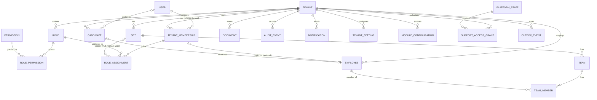

# Initial Data Model (Foundation)

- **Status:** Proposed for Milestone 2. Release 1 business tables are designed per module later.
- **Conventions:**
  - Primary keys are `uuid` (UUIDv7, time-ordered).
  - Column names are `snake_case` in the database and `camelCase` in Prisma.
  - Timestamps are `timestamptz`, stored in UTC. The tenant's display timezone defaults to `Europe/London`.
  - Money is `numeric(14,4)` (PAY-04). Floating point is never used for money.

## 1. Global vs tenant-owned

| Global (no `tenant_id`, no RLS) | Tenant-owned (`tenant_id NOT NULL`, RLS, `UNIQUE(tenant_id,id)`, composite FKs) |
|---|---|
| `user`, `session`, `account`, `verification`, `two_factor`, `passkey` (Better Auth) | `tenant_membership` |
| `tenant` (the registry itself) | `role`, `role_permission`, `role_assignment` |
| `platform_staff` | `site`, `team`, `team_member` |
| `permission` (catalogue mirrored from code) | `employee` |
| `platform_audit_event` (platform-staff actions) | `candidate` |
| `processed_event` (job idempotency; holds `tenant_id` but is infrastructure) | `document` |
| | `audit_event` |
| | `notification`, `notification_preference` |
| | `tenant_setting`, `module_configuration` |
| | `support_access_grant` |
| | `outbox_event` |

`session` carries `active_tenant_id`. It is set only by the tenant-switch endpoint after a membership check.

## 2. Entities



### Key columns, constraints and indexes

| Table | Key columns | Constraints / indexes | On delete |
|---|---|---|---|
| `tenant` | `id, slug, legal_name, status (active/suspended/offboarding/closed), data_region, created_at` | `UNIQUE(slug)` | Never hard-deleted by the app. Purged by the offboarding procedure. |
| `user` | Better Auth fields; `email` nullable, `phone_number` nullable | `UNIQUE(lower(email))`, `UNIQUE(phone_number)`, `CHECK(email IS NOT NULL OR phone_number IS NOT NULL)` | Anonymised, not deleted, if referenced by audit |
| `tenant_membership` | `tenant_id, user_id, status (invited/active/suspended/left), invited_by, permissions_version int` | `UNIQUE(tenant_id, user_id)`; index `(user_id)` | RESTRICT |
| `role` | `tenant_id, key, name, is_system` | `UNIQUE(tenant_id, key)` | RESTRICT if assigned |
| `role_permission` | `tenant_id, role_id, permission_code` | PK `(tenant_id, role_id, permission_code)`; FK `permission_code → permission.code` | CASCADE with role (configuration, not personal data) |
| `role_assignment` | `tenant_id, membership_id, role_id, site_id NULL` | `UNIQUE NULLS NOT DISTINCT (tenant_id, membership_id, role_id, site_id)`; index `(tenant_id, membership_id)` | CASCADE when the membership is removed, with an audit event |
| `site` | `tenant_id, name, code, address, timezone, status` | `UNIQUE(tenant_id, code)` | Archive (status), not delete |
| `team` / `team_member` | `tenant_id, site_id, name` / `tenant_id, team_id, employee_id` | Composite FKs | Archive |
| `employee` | `tenant_id, membership_id NULL, employee_number, legal names, preferred_name, contact, employment_status, start_date, end_date, primary_site_id, source_candidate_id NULL` | `UNIQUE(tenant_id, employee_number)`, `UNIQUE(tenant_id, membership_id)` | **RESTRICT.** Leavers are set to `status = left`. Erasure follows the retention policy (§4). |
| `candidate` | `tenant_id, user_id NULL, names, email, phone, status` | `UNIQUE(tenant_id, user_id)` | RESTRICT; retention-based erasure |
| `document` | `tenant_id, owner_type, owner_id, doc_type, sensitivity (standard/confidential/restricted), storage_key, mime_type, size_bytes, sha256, scan_status, expires_on NULL, retention_class, uploaded_by, deleted_at` | Index `(tenant_id, owner_type, owner_id)`, index `(tenant_id, expires_on)` | Soft-delete plus a retention purge job |
| `audit_event` | `id, tenant_id, occurred_at, actor_user_id, actor_type (user/support/system), support_grant_id NULL, action, resource_type, resource_id, ip, user_agent, request_id, changes jsonb (redacted)` | Index `(tenant_id, occurred_at DESC)`, index `(tenant_id, resource_type, resource_id)`. **App role has INSERT+SELECT only**, plus a trigger that rejects UPDATE/DELETE (AUD-02). | Never deleted by the app. Retention to be set (open question). |
| `notification` | `tenant_id, recipient_membership_id, channel, template_key, payload_ref, status, read_at` | Index `(tenant_id, recipient_membership_id, read_at)` | Purged after N days |
| `tenant_setting` | `tenant_id, key, value jsonb, updated_by` | PK `(tenant_id, key)`; values validated by a Zod schema per key | — |
| `module_configuration` | `tenant_id, module_key, enabled, config jsonb` | PK `(tenant_id, module_key)` | — |
| `support_access_grant` | `tenant_id, platform_staff_id, reason, scope, approved_by, starts_at, expires_at, revoked_at` | Index `(tenant_id, expires_at)` | Kept for audit |
| `outbox_event` | `id, tenant_id, type, payload jsonb (IDs only), created_at, published_at NULL, attempts` | Partial index `WHERE published_at IS NULL` | Purged after publishing plus 30 days |

Every tenant-owned table also has `created_at`, `updated_at`, and `created_by` where useful.

## 3. Cross-tenant relationship prevention

Every tenant-owned FK includes `tenant_id`. For example:

```sql
ALTER TABLE role_assignment
  ADD CONSTRAINT role_assignment_site_fk
  FOREIGN KEY (tenant_id, site_id) REFERENCES site (tenant_id, id);
```

With RLS on top, a row can never reference, or be read through, another tenant's row.

## 4. Deletion and retention

- **No `ON DELETE CASCADE`** from `tenant`, `employee`, `candidate` or `document`. A leaver is a status change, never a delete.
- Personal-data erasure (UK GDPR rights, retention expiry) is a **service operation**. It anonymises fields, deletes stored objects, and writes an audit event. Retention periods per class (CVs of unsuccessful candidates, right-to-work evidence, and so on) **await TH-DEV-06 and legal advice**. Until then, nothing auto-deletes.
- **Tenant offboarding (MT-07)** runs in stages:
  1. `status = offboarding`, which blocks all sign-in.
  2. Full export (JSON/CSV plus documents) delivered to the client.
  3. A grace period.
  4. A scripted purge in dependency order, with a platform audit record.

  The purge needs two-person approval at Macrovision.

## 5. Payroll readiness (no tables built yet)

This is reserved shape, so later releases don't force a rewrite:

- `pay_rule_set(effective_from, tax_year, version)` is immutable once used.
- `pay_run(status draft→approved→finalised)`: a finalised run is locked by trigger.
- `pay_adjustment` handles corrections. History is never edited.
- Approved attendance enters a pay run as a snapshot reference, not a live join.

## 6. Open questions

- Audit retention period, and whether audit events for a closed tenant are kept after a purge (legal advice needed).
- Employee number: auto-generated per tenant, or supplied by the client?
- Does a worker at two sites of the same tenant have one `employee` record? **Yes (proposed):** one employee, with many sites through team membership and role scope.
