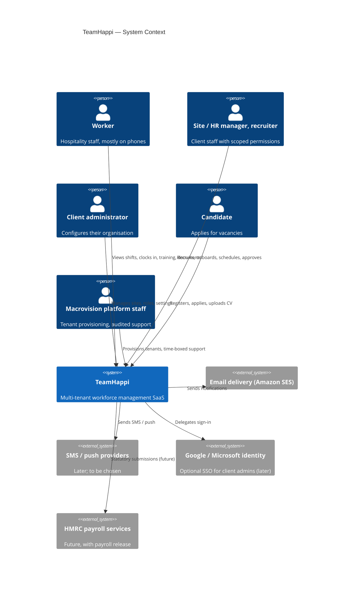
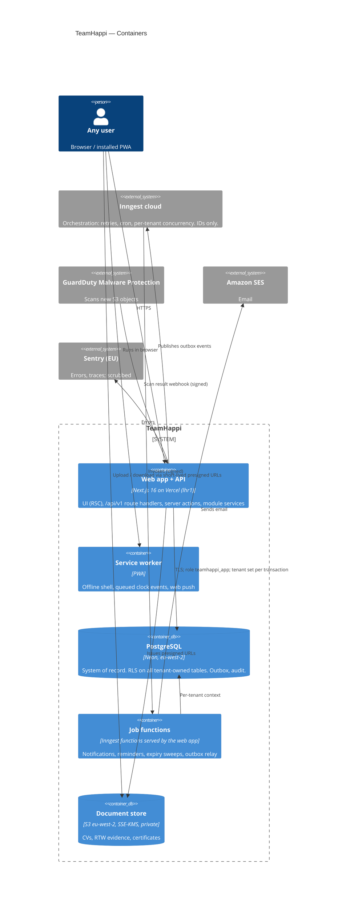

# TH-DEV-05 — Technical Architecture Proposal

| Field | Value |
|---|---|
| Version | 0.1 — Sprint 0 draft for product-owner review |
| Date | 8 October 2026 |
| Responds to | TH-DEV-02 v0.1, TH-DEV-04 v0.1 |

## 1. Summary

TeamHappi will be built as one **TypeScript modular monolith on Next.js**, hosted on **Vercel (London)**, with **Neon PostgreSQL (London)** as the single system of record.

Supporting services:

- Private **S3** for documents, with malware scanning
- **Inngest** for background jobs, fed by a **transactional outbox**
- **SES** for email

Tenants share one database and schema. Isolation is enforced twice:

1. A **mandatory tenant-scoped data-access layer** in the application.
2. **PostgreSQL Row-Level Security** in the database, with composite tenant foreign keys that make cross-tenant links impossible at the database level.

| Decision | ADR |
|---|---|
| Tenancy model | [ADR-0001](../decisions/0001-multi-tenancy-model.md) |
| Stack and versions | [ADR-0002](../decisions/0002-technology-stack.md) |
| Hosting, environments, residency | [ADR-0003](../decisions/0003-hosting-and-data-residency.md) |
| Authentication / authorisation | [ADR-0004](../decisions/0004-authentication.md) |
| Client application (PWA) | [ADR-0005](../decisions/0005-client-application-approach.md) |
| Background jobs and outbox | [ADR-0006](../decisions/0006-background-jobs-and-outbox.md) |
| Document storage | [ADR-0007](../decisions/0007-document-storage.md) |

## 2. C4 Level 1 — System context



## 3. C4 Level 2 — Containers



## 4. Request lifecycle (tenant isolation path)

```
Request ─► middleware: security headers, rate limit (per IP, then per tenant)
        ─► auth: session cookie → Better Auth session → userId
        ─► tenancy: session.activeTenantId → membership active? tenant active? → TenantContext
        ─► authz: require("rota.shift.publish", { siteId }) against role assignments
        ─► validation: Zod schema on input
        ─► service: business rules; TenantDb.tx(...) { set_config('app.tenant_id'); writes; audit; outbox }
        ─► response: typed DTO (no raw DB rows); errors mapped to safe problem+json
```

`TenantContext` can only be constructed by the tenancy module. Repositories accept only `TenantDb`. Both are enforced by types and lint rules.

## 5. Source layout

```
src/
  app/                      Next.js routes only (thin): (marketing), (auth), (app)/[...], (candidate), (platform), api/v1/...
  components/ui|layout      Design system (shadcn/ui-derived)
  lib/
    auth/                   Better Auth configuration, session helpers
    db/                     Prisma clients: raw (migrator/platform-only) and TenantDb factory
    tenancy/                TenantContext resolution, active-tenant switching
    permissions/            Permission catalogue, require(), scope checks
    validation/             Shared Zod helpers
    observability/          Logger (tenant-tagged, redacted), Sentry
  platform/                 Shared platform services: documents, audit, notifications, outbox, settings, module-config
  modules/                  recruitment | onboarding | training | rota | attendance | administration
  shared/                   Pure utilities and types (no I/O)
tests/ unit | integration | security | e2e
prisma/ schema.prisma, migrations/ (hand-reviewed SQL incl. RLS)
```

Folders are created when they get their first real code, not in advance.

## 6. Deployment strategy (summary)

The full strategy is in [deployment-strategy.md](../development/deployment-strategy.md).

- Trunk-based development: short-lived branches, then a PR into `main`.
- Each PR gets a Vercel preview and its own Neon branch with synthetic data.
- Merging to `main` deploys to staging and runs migrations there.
- **Production promotion is manual and approved by the product owner.** The migration job runs first, then the app deploys.
- Migrations follow expand/contract, so they are backward compatible with the running version. **Destructive migrations need explicit product-owner approval.**

## 7. Operational cost assumptions

The full list is in [cost-assumptions.md](cost-assumptions.md). Rough development-phase cost is **£50–£120 per month**. Rough early production cost (a handful of tenants) is **£150–£400 per month**, excluding SMS. Every figure must be confirmed against current provider pricing before purchase.

## 8. Key risks

| Risk | Mitigation |
|---|---|
| Missed tenant filter or RLS policy | Two layers, plus composite foreign keys, plus a CI check that every `tenant_id` table has a policy, plus the isolation test suite |
| Missing TH-DEV-03/06/07/08 drive rework | Provisional assumptions are flagged. Milestones 3 and 4 are blocked until they arrive. |
| iOS push and offline limits of a PWA | ADR-0005 fallback: a native wrapper reusing the API |
| Vendor count (Vercel, Neon, AWS, Inngest, Sentry) | Each service stays behind a small interface (`storage`, `mailer`, `jobs`). Infrastructure is managed as code. |
| Payroll correctness later | PAY-01..06 shape the data model now: decimal money, versioned rules, immutable finalised runs. No calculations until specialists sign off. |
| Single developer and AI-assisted delivery | Small PRs, CI gates, and a security test suite that is required to pass |
